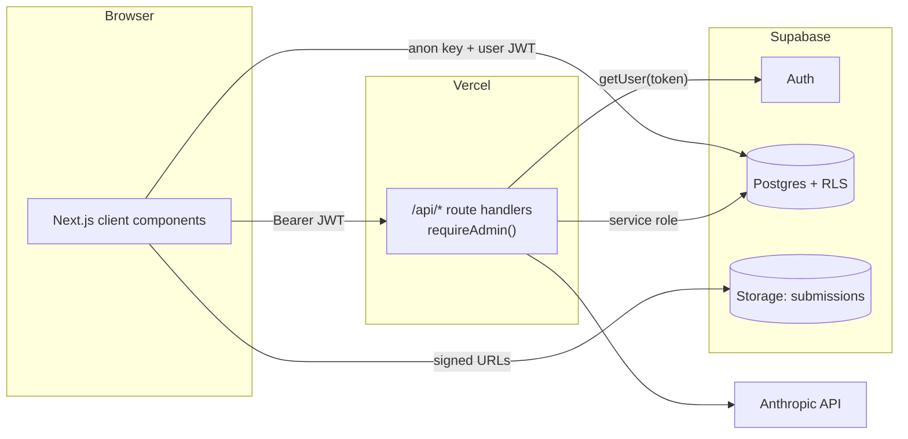

# Portal de Onboarding de Clientes

[](https://github.com/tomashanna/Project1/actions/workflows/ci.yml)

Portal web para gestionar el onboarding de clientes B2B de una plataforma de asistentes de IA. Cada cliente ve un **Portal de Status** con las fases y tareas de su proyecto, sube información y archivos, y valida entregables. El equipo interno administra clientes, plantillas de proyecto y un **pipeline de IA** que limpia y estructura la información recibida antes de usarla para configurar asistentes.

**Stack:** Next.js 16 (App Router) · React 19 · TypeScript · Tailwind CSS 4 · Supabase (Auth, Postgres con RLS, Storage) · Anthropic Claude API · Vercel

## Funcionalidades

| Rol | Qué puede hacer |
|---|---|
| **Cliente** | Ver el avance de su proyecto por fases · responder solicitudes de información y subir archivos · revisar y validar documentos |
| **Admin** | Invitar clientes y admins · crear proyectos desde plantillas · editar plantillas (fases, tareas, preguntas) · depurar con IA la información de cada cliente · exportar |

## Arquitectura



- **Lecturas y escrituras del cliente** van directo a Supabase con la anon key; la autorización la impone **Row Level Security**.
- **Acciones privilegiadas** (invitar, eliminar clientes, buscar usuarios, depurar con IA) pasan por route handlers que verifican la sesión con Supabase Auth y el rol en `profiles` antes de usar la service role. Ver [`lib/server/auth.ts`](lib/server/auth.ts).

Detalle del modelo de datos y los flujos en [docs/ARCHITECTURE.md](docs/ARCHITECTURE.md).

## Puesta en marcha

Requisitos: Node.js 22+ y un proyecto de Supabase.

```bash
npm ci
cp .env.example .env.local   # completar valores
npm run dev                  # http://localhost:3000
```

| Variable | Requerida | Descripción |
|---|---|---|
| `NEXT_PUBLIC_SUPABASE_URL` | Sí | URL del proyecto Supabase |
| `NEXT_PUBLIC_SUPABASE_ANON_KEY` | Sí | Clave pública (se incrusta en el bundle al compilar) |
| `SUPABASE_SERVICE_ROLE_KEY` | Sí | Solo servidor. Salta RLS: nunca con prefijo `NEXT_PUBLIC_` |
| `NEXT_PUBLIC_SITE_URL` | Sí | URL pública, usada en los correos de invitación |
| `ANTHROPIC_API_KEY` | Para el pipeline | Clave de la API de Anthropic |
| `ANTHROPIC_MODEL` | No | Modelo para depurar (por defecto `claude-sonnet-5-5`) |
| `ADMIN_EMAILS` | No | Allowlist de emergencia (emails confirmados) |

Antes de producción aplica [`supabase/hardening.sql`](supabase/hardening.sql) y desactiva el registro público en **Supabase → Authentication → Sign In / Providers → Allow new users to sign up**. El acceso es solo por invitación.

## Calidad

```bash
npm run check      # lint + typecheck + tests
npm test           # vitest
npm run build      # build de producción
```

- **Tests** (`tests/unit`): autorización de cada endpoint (incluida una regresión con un JWT falsificado), validación de entrada, construcción de prompts y saneamiento de nombres de archivo. Sin red: Supabase y Anthropic se simulan.
- **CI** (GitHub Actions): lint, typecheck, tests, build y escaneo de secretos con gitleaks en cada push y PR.
- **Dependabot** para npm y GitHub Actions.

## Guardrails del pipeline de IA

`/api/depure` limpia el texto de un cliente con Claude:

- Solo admins autenticados; cuerpo validado con zod; máximo 40 000 caracteres (413 si se excede).
- El texto del cliente va delimitado (`<texto_cliente>`) y el system prompt indica tratarlo como datos, no como instrucciones (mitiga prompt injection).
- Timeout de 90 s, 2 reintentos, fallback del lado del servidor si el modelo rechaza, y manejo de `refusal` y `max_tokens`.
- Los errores del proveedor no se reenvían al cliente.

## Estructura

```
app/
  api/            Route handlers privilegiados (auth en servidor)
  components/     Componentes compartidos y del portal
  dashboard/      Vistas de admin, portal de cliente y onboarding legado
  contexts/       AuthContext
lib/
  server/         Código solo de servidor (auth, prompts)
  supabase.ts     Cliente del navegador (anon key)
supabase/         SQL de endurecimiento
tests/            Vitest
docs/             Arquitectura
```

## Roadmap técnico

- Migrar el fetching de datos en efectos a SWR/React Query (hoy son warnings de lint).
- Versionar el esquema completo y las políticas RLS como migraciones de Supabase.
- Tests end-to-end con Playwright contra un proyecto Supabase local.
- Middleware con `@supabase/ssr` para proteger rutas en el servidor.

## Seguridad

Ver [SECURITY.md](SECURITY.md).
